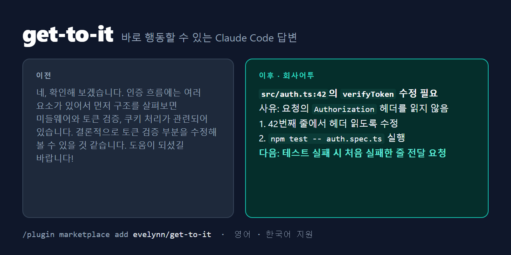

# get-to-it

[English](README.md) | **한국어**



**효과 한눈에 보기** ([적용 예시](#적용-예시) 1·2 기준)

| 답변에서 바로 얻는 것 | 이전 | 이후 |
| --- | --- | --- |
| 첫 줄 | 인사("네, 확인해 보겠습니다") | 할 일(`src/auth.ts:42`의 `verifyToken` 수정 필요) |
| 고칠 위치 | 없음 | `src/auth.ts:42` |
| 원인 | 없음 | `Authorization` 헤더를 읽지 않음 |
| 실행할 명령 | 없음 | `npm test -- auth.spec.ts` |
| 사용자가 할 일 | 없음 | 실패 시 처음 실패한 줄 전달 |
| 인사·결산·맺음 문장 | 3개 | 0개 |
| 진행 위치 | "곧 완료" | 3/5단계 완료 |
| 남은 시간 | 없음 | 약 5분 |

**토큰 사용량** (실측: 질문 10개 × 한국어·영어 × 끔·켬 = 40회, 질문 1건 평균)

```mermaid
%%{init: {"themeVariables": {"xyChart": {"plotColorPalette": "#94a3b8, #0d9488"}}}}%%
xychart-beta
    title "출력 토큰 (낮을수록 좋음)"
    x-axis ["한국어 끔", "한국어 켬", "영어 끔", "영어 켬"]
    y-axis 0 --> 1400
    bar [1194, 0, 916, 0]
    bar [0, 879, 0, 616]
```

```mermaid
%%{init: {"themeVariables": {"xyChart": {"plotColorPalette": "#94a3b8, #0d9488"}}}}%%
xychart-beta
    title "입력 토큰 (규칙 글 포함)"
    x-axis ["한국어 끔", "한국어 켬", "영어 끔", "영어 켬"]
    y-axis 0 --> 14000
    bar [8574, 0, 8540, 0]
    bar [0, 12587, 0, 10634]
```





| 항목 | 한국어 끔 | 한국어 켬 | 영어 끔 | 영어 켬 |
| --- | ---: | ---: | ---: | ---: |
| 출력 토큰(답변+생각) | 1,194 | 879 (-26%) | 916 | 616 (-33%) |
| 답변 글자 수 | 1,570 | 1,170 (-25%) | 2,252 | 1,451 (-36%) |
| 입력 토큰 | 8,574 | 12,587 (+47%) | 8,540 | 10,634 (+25%) |

- 출력 토큰: 한국어 26%, 영어 33% 감소
- 입력 토큰: 규칙 글이 요청마다 더해져 증가. 요청 1회당 한국어 약 4,800, 영어 약 2,500 토큰
- 측정 조건: 2026-11-19, `claude-opus-5-5`, 빈 폴더, 사용자 설정·CLAUDE.md·MCP 없음, 읽기 전용 도구만, 질문마다 1회 실행
- 켬 조건: 훅이 주입하는 규칙 글을 `--append-system-prompt-file`로 붙여 실행
- 재현: `node bench/token-usage.mjs`, 원자료: [`bench/results.json`](bench/results.json)

Claude Code 답변을 회사 보고서 보고체(회사어투)로 바꾸는 플러그인.

- 첫 줄은 할 일
- 단계는 번호로 구분
- AI 특유의 표현 대신 회사에서 쓰는 쉬운 말 사용
- 사용 대상: 요점부터 듣고 싶은 사용자
- 기본 언어: 영어. 한국어는 별도 규칙(번역투 없는 한국어, 국내 회사 보고서 문체) 제공

## 스킬 구성

| 스킬 | 대상 | 시작 방법 |
| --- | --- | --- |
| `get-to-it` | 채팅 답변, 업무 보고서(보고체) | `/get-to-it:get-to-it` 입력, 항상 켜기 파일, 보고서 요청 시 자동 |
| `long-form` | 문서, README, 메일, 공지, UI 문구, 윤문, 번역 | 해당 글 요청 시 자동 또는 `/get-to-it:long-form` 입력 |

- 규칙 파일: 스킬마다 언어별로 1개
- 작업 1건에는 필요한 파일 1개만 읽음: [`skills/`](skills)

## 설치

- 소요 시간: 약 2분
- 필요 항목: Claude Code, Node.js
- Node.js가 없으면 세션 시작마다 훅 오류가 기록됨. 세션은 계속 진행됨

1. Claude Code 세션 안에서 플러그인 설치.

   ```
   /plugin marketplace add evelynn/get-to-it
   /plugin install get-to-it@get-to-it
   ```

2. 새 세션 시작(`/exit` 후 `claude`) 후 규칙 켜기.

   ```
   /get-to-it:get-to-it
   ```

3. 오류 해결 방법 질문. 답변 첫 줄이 할 일이면 정상 적용.

새 세션마다 자동으로 켜려면 터미널에서 아래 파일 생성. 다음 새 세션부터 적용.

```bash
# macOS, Linux, Git Bash
touch ~/.claude/.get-to-it-always
```

```powershell
# PowerShell
New-Item -ItemType File "$HOME\.claude\.get-to-it-always"
```

## 언어

- 기본 언어: 영어
- 한국어 규칙: 답변·보고서는 [`references/ko/`](skills/get-to-it/references/ko), 긴 글·윤문·번역은 [`long-form/ko.md`](skills/long-form/ko.md)
- 그 외 언어: 같은 규칙을 해당 언어의 업무 문체에 맞게 적용

1. 현재 세션만 변경: "한국어 모드" 또는 "영어 모드" 입력.
2. 새 세션마다 적용: `~/.claude/.get-to-it-lang`에 `ko` 기록.

   ```bash
   # macOS, Linux, Git Bash
   echo ko > ~/.claude/.get-to-it-lang
   ```

   ```powershell
   # PowerShell
   Set-Content "$HOME\.claude\.get-to-it-lang" ko
   ```

- 파일이 없으면 영어 적용
- 언어 파일은 `.get-to-it-always` 파일이 있어야 적용됨

## 회사어투

- 적용 대상: 채팅 답변, 업무 보고서, 새로 쓰는 긴 글(문서, README, 메일, 공지)
- 문장 끝: "~함", "~완료", "~필요", "~예정", "~요청" 같은 보고체
- 단어: 회사에서 실제로 쓰는 쉬운 말
- 보고서 양식 글: 국내 회사 실제 보고서 문체(개조식, 번역투 금지)
- 다른 어체: 사용자가 따로 요청할 때만 사용
- 윤문·번역: 원문의 격식 유지
- 규칙: [`references/ko/rules.md`](skills/get-to-it/references/ko/rules.md) 3장, 긴 글은 [`long-form/ko.md`](skills/long-form/ko.md) 2절

### 달라지는 문장

| 일반 문장 | 회사어투 |
| --- | --- |
| DB를 확인하고 고쳤습니다. | DB 확인 후 수정 완료 |
| 원인은 캐시입니다. | 원인: 캐시 |
| 서버를 재시작해야 합니다. | 서버 재시작 필요 |
| 내일 배포합니다. | 내일 배포 예정 |
| 캐시가 원인일 수 있습니다. | 캐시 원인 가능성 있음(확인 필요) |
| 다음: 처음 실패한 줄을 붙여 주세요. | 다음: 처음 실패한 줄 전달 요청 |

### 보고 예시

규칙 설명용으로 직접 작성한 글.

일반 답변:

> 로그인 오류를 확인했습니다. 원인은 캐시로 보이지만 아직 확실하지 않습니다. 테스트 3건이 실패했고 내일 배포할 예정입니다.

회사어투:

> 로그인 오류 확인 완료
>
> 원인: 캐시 가능성 있음(확인 필요)
>
> 테스트 3건 실패
>
> 내일 배포 예정
>
> 다음: 실패 로그 첫 줄 전달 요청

## 적용 예시

- 규칙 설명용으로 직접 작성한 글
- 한국어 설정 기준
- 실제 답변은 모델과 대화 내용에 따라 다름

### 예시 1. 오류를 고칠 때

요청: 로그인하면 401이 나와. 어떻게 고쳐?

이전:

> 네, 확인해 보겠습니다. 인증 흐름에는 여러 요소가 있어서 먼저 구조를 살펴보면 미들웨어와 토큰 검증, 쿠키 처리가 관련되어 있습니다. 결론적으로 토큰 검증 부분을 수정해 볼 수 있을 것 같습니다. 참고로 의존성 버전도 낡았습니다. 도움이 되셨길 바랍니다!

이후:

> `src/auth.ts:42`의 `verifyToken` 수정 필요
>
> 사유: 요청의 `Authorization` 헤더를 읽지 않음
>
> 1. 42번째 줄에서 헤더를 읽도록 수정
> 2. `npm test -- auth.spec.ts` 실행
>
> 다음: 테스트 실패 시 처음 실패한 줄 전달 요청

- 첫 줄을 할 일로 변경
- 의존성 문제는 현재 문제를 끝낸 뒤 별도 확인

### 예시 2. 작업이 길어질 때

요청: API 문서 5개를 한국어로 옮겨 줘.

이전:

> 번역 작업을 진행하고 있습니다. 조금만 기다려 주시면 곧 완료될 예정입니다.

이후:

> 3/5단계 완료: 인증 문서 번역
>
> 남은 시간: 약 5분. 이어서 결제 문서 번역 예정

- 진행 위치를 매번 다시 표기
- 시간은 숫자로 표기
- 사용자가 할 일이 없으므로 "다음:" 줄 없음

### 예시 3. 되돌리기 어려운 작업

요청: 오래된 브랜치 다 지워 줘.

이후:

> 삭제 전 확인 필요
>
> 대상: 12개. `feature/payment`, `fix/login` 미병합
>
> 삭제하면 두 브랜치의 커밋을 찾기 어려움
>
> 다음: 병합된 10개만 삭제·12개 전체 삭제 중 선택 요청

- 삭제, 강제 push, 스키마 변경은 사전 확인 필수

### 예시 4. 문장 바꾸기

| 이전 | 이후 |
| --- | --- |
| 배포에 있어서 중요한 점은 환경 변수입니다. | 배포 시 중요 항목: 환경 변수 |
| 스크립트에 의해 생성된 파일을 통해 검증을 진행합니다. | 스크립트가 만든 파일로 검증 |
| 강한 성능을 가지고 있습니다. | 성능 좋음 |
| 결론적으로, 캐시가 원인이라는 것입니다. | 원인: 캐시 |

## 켜기와 끄기

| 하려는 일 | 방법 |
| --- | --- |
| 이 세션에서만 켜기 | `/get-to-it:get-to-it` 입력 |
| 이 세션에서 끄기 | "get-to-it 꺼", "normal mode", "stop get-to-it" 중 하나 입력 |
| 새 세션마다 켜기 | `~/.claude/.get-to-it-always` 파일 생성 |
| 새 세션마다 켜기 해제 | 위 파일 삭제 |
| 이 세션에서 언어 변경 | "한국어 모드", "영어 모드" 입력 |
| 새 세션마다 한국어 적용 | `~/.claude/.get-to-it-lang`에 `ko` 기록 |
| 영어로 복귀 | `~/.claude/.get-to-it-lang` 삭제 |

- 언어 파일은 `.get-to-it-always` 파일이 있어야 적용됨
- 항상 켜기 파일이 있으면 세션 중에 꺼도 대화 압축이나 `/clear` 후 규칙이 다시 적용됨

## 라이선스

MIT. [`LICENSE`](LICENSE) 참고.
