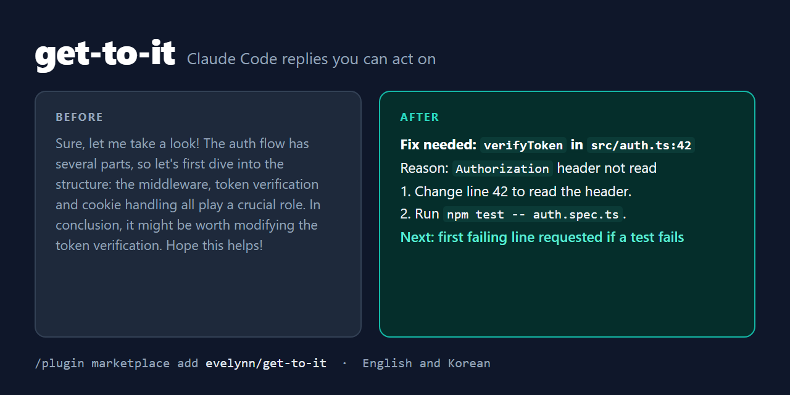
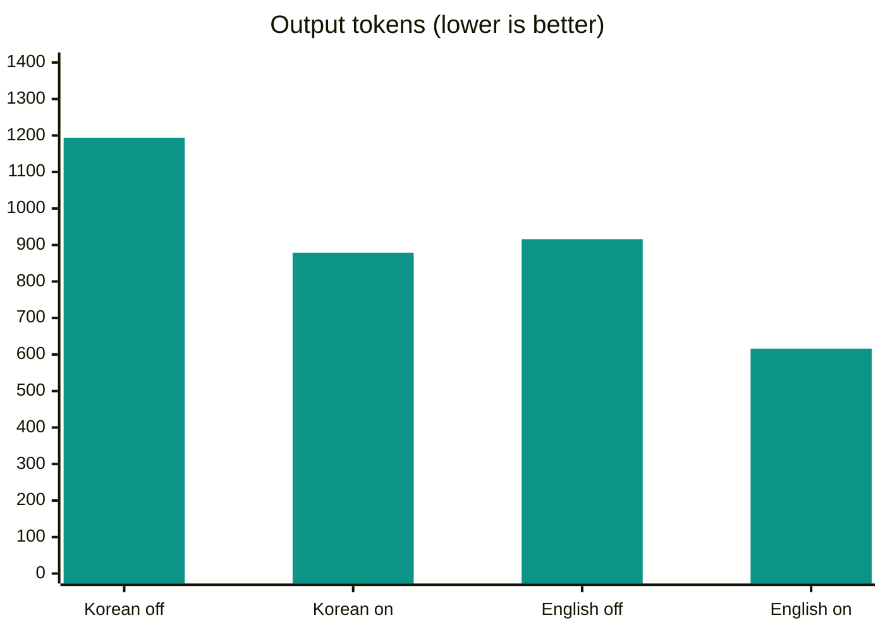
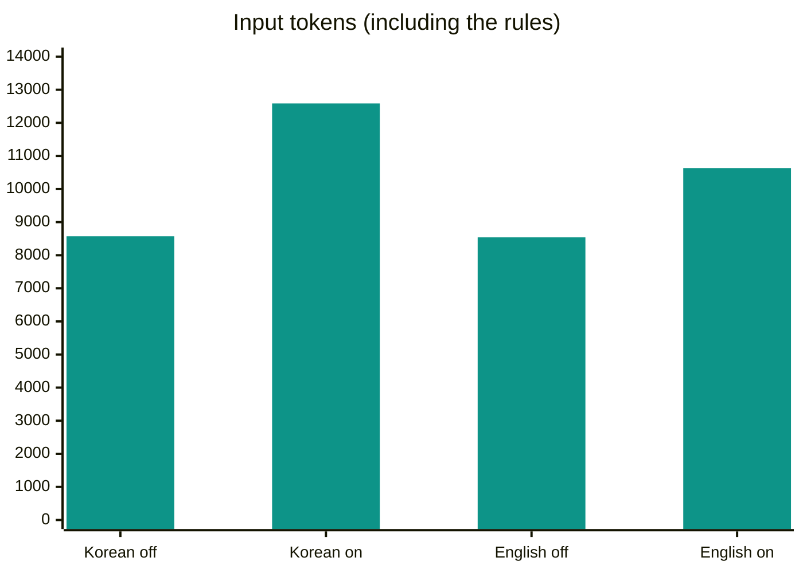

# get-to-it

**English** | [한국어](README.ko.md)



**At a glance** (from [Examples](#examples) 1 and 2)

| What the reply gives you | Before | After |
| --- | --- | --- |
| First line | Small talk ("Sure, let me take a look!") | The action (fix `verifyToken` in `src/auth.ts:42`) |
| Where to fix | Not given | `src/auth.ts:42` |
| Cause | Not given | `Authorization` header not read |
| Command to run | Not given | `npm test -- auth.spec.ts` |
| Your next step | Not given | Paste the first failing line if a test fails |
| Greeting, recap and sign-off sentences | 3 | 0 |
| Progress | "finished soon" | Step 3/5 done |
| Time left | Not given | About 5 minutes |

**Token usage** (measured: 10 questions × Korean and English × off and on = 40 runs, average per question)





| Measure | Korean off | Korean on | English off | English on |
| --- | ---: | ---: | ---: | ---: |
| Output tokens (answer + thinking) | 1,194 | 879 (-26%) | 916 | 616 (-33%) |
| Answer characters | 1,570 | 1,170 (-25%) | 2,252 | 1,451 (-36%) |
| Input tokens | 8,574 | 12,587 (+47%) | 8,540 | 10,634 (+25%) |

- Output tokens drop 26% in Korean and 33% in English.
- Input tokens rise because the rules are sent with every request: about 4,800 tokens per request in Korean, 2,500 in English.
How it was measured

- Date and model: 2026-11-19, `claude-opus-5-5`.
- Questions: 10 developer questions (a 401 on JWT login, changing the last commit message, an npm ERESOLVE error and so on), with the same content in Korean and English.
- Environment: an empty temporary folder. No user settings, CLAUDE.md or MCP. Only read-only tools (Read, Glob, Grep) allowed.
- "On" runs: the text the hook injects is added with `--append-system-prompt-file`. In real use, the session-start hook injects the same text.
- Totals: one off run and one on run per question, averaged over the 10 questions. Output tokens are answer plus thinking tokens. Input tokens are the full input, including cache reads and writes.
- Reproduce: `node bench/token-usage.mjs`. Raw data: [`bench/results.json`](bench/results.json)

Limits

- One run per question. Answer length varies between runs of the same question, and that variance is not captured. Read the results as an average trend only.
- The first measurement was discarded. With all tools turned off, the model kept calling `ls` and 6 runs used about 128,000 tokens each. Those outliers would have inflated the saving past 97%, so the runs were repeated with read-only tools allowed.
- Only single short questions were measured. Long conversations and file-heavy work were not.
- Cost was not measured. Whether more input tokens and fewer output tokens cost more or less depends on the pricing plan and on caching.

A Claude Code plugin that answers in company tone: short business-report lines you can act on. The first line is the next step, steps are numbered, and AI filler gives way to the plain words people use at work.

It is for anyone who wants Claude to get to the point. English is the default. Korean has its own full rule set, including natural Korean without translated-sounding phrasing and Korean business-report style.

## Skills

| Skill | Used for | How it starts |
| --- | --- | --- |
| `get-to-it` | Chat replies and work reports in short status lines | `/get-to-it:get-to-it`, the always-on file, or automatically when you ask for a report |
| `long-form` | Documents, READMEs, email, notices, UI copy, editing and translation | Automatically when you ask for that kind of text, or `/get-to-it:long-form` |

Each skill has one rule file per language, so a task reads only the file it needs: [`skills/`](skills)

## Install

Takes about 2 minutes. You need Claude Code and Node.js. Without Node.js, a hook error is logged at each session start, but the session continues.

1. Install the plugin inside a Claude Code session.

   ```
   /plugin marketplace add evelynn/get-to-it
   /plugin install get-to-it@get-to-it
   ```

2. Open a new session (`/exit`, then `claude`) and turn the rules on.

   ```
   /get-to-it:get-to-it
   ```

3. Ask how to fix an error. It is on if the first line is the action to take.

To turn it on in every new session, create a flag file in your terminal. It applies from the next new session.

```bash
# macOS, Linux, Git Bash
touch ~/.claude/.get-to-it-always
```

```powershell
# PowerShell
New-Item -ItemType File "$HOME\.claude\.get-to-it-always"
```

## Language

English is the default. Korean has its own rule set for natural Korean and Korean company reports: [`references/ko/`](skills/get-to-it/references/ko) for replies and reports, [`long-form/ko.md`](skills/long-form/ko.md) for documents, editing and translation. In any other language, the same rules apply in that language's business style.

1. For the current session only, say "Korean mode" or "English mode".
2. For every new session, write `ko` to `~/.claude/.get-to-it-lang`. Without the file, English is used. The file only works together with `.get-to-it-always`.

   ```bash
   # macOS, Linux, Git Bash
   echo ko > ~/.claude/.get-to-it-lang
   ```

   ```powershell
   # PowerShell
   Set-Content "$HOME\.claude\.get-to-it-lang" ko
   ```

## Company tone

Chat replies and work reports come as the short lines people write in status updates ("Fixed the token check", "Cause: cache", "Restart the server") in everyday work words. Email, notices, README and docs keep their usual register in English. In Korean, new long text is also written in company tone unless you ask for another register. Rules: [`SKILL.md` chapter 3](skills/get-to-it/SKILL.md)

### How sentences change

| Ordinary sentence | Company tone |
| --- | --- |
| I went ahead and checked the DB, and I was able to fix it. | Checked the DB and fixed it |
| The cause is the cache. | Cause: cache |
| You need to restart the server. | Restart the server |
| We'll deploy tomorrow. | Deploying tomorrow |
| The cache might be the cause. | Possible cause: cache (unconfirmed) |
| Could you paste the first failing line? | Paste the first failing line |

### Report example

Written by hand to illustrate the rules.

Ordinary reply:

> I checked the login error. The cause looks like the cache, but that is not certain yet. Three tests failed, and we plan to deploy tomorrow.

Company tone:

> Checked the login error
>
> Possible cause: cache (unconfirmed)
>
> 3 tests failed
>
> Deploying tomorrow
>
> Next: paste the first line of the failure log

## Examples

These examples are written by hand to illustrate the rules. Actual replies vary with the model and conversation.

### Example 1. Fixing an error

Request: I get a 401 when I log in. How do I fix it?

Before:

> Sure, let me take a look! The auth flow has several parts, so let's first dive into the structure: the middleware, token verification and cookie handling all play a crucial role. In conclusion, it might be worth modifying the token verification. By the way, your dependencies are also out of date. Hope this helps!

After:

> Fix `verifyToken` in `src/auth.ts:42`
>
> Reason: request's `Authorization` header not read
>
> 1. Change line 42 to read the header.
> 2. Run `npm test -- auth.spec.ts`.
>
> Next: if a test fails, paste the first failing line

The first line is the action. The dependency topic waits until the current problem is done.

### Example 2. Long-running work

Request: Translate these 5 API documents into Korean.

Before:

> The translation is in progress. Please wait a moment and it will be finished soon.

After:

> Step 3/5 done: auth document translated
>
> Time left: about 5 minutes. Payment document next

Progress is restated every time, and time is a number. No "Next:" line, since the user has nothing to do.

### Example 3. Hard-to-reverse work

Request: Delete all the old branches.

After:

> Confirmation needed before deleting
>
> Targets: 12 branches. `feature/payment` and `fix/login` not merged.
>
> Deleting them makes their commits hard to find.
>
> Next: pick the 10 merged branches or all 12

Deletes, force pushes and schema changes get a confirmation first.

### Example 4. Plain words

| Before | After |
| --- | --- |
| Let's delve into the logs to ensure a seamless deployment. | Check the logs before deploying |
| It's important to note that environment variables play a crucial role in deployment. | Deploy depends on environment variables |
| We should leverage the existing cache layer in order to improve performance. | Proposal: reuse the existing cache for speed |
| In conclusion, it is the cache that is the cause. | Cause: cache |

## Turning it on and off

| Goal | How |
| --- | --- |
| Turn on for this session | Type `/get-to-it:get-to-it` |
| Turn off for this session | Say "normal mode" or "stop get-to-it" |
| Turn on for every new session | Create `~/.claude/.get-to-it-always` |
| Stop turning on for new sessions | Delete that file |
| Change language for this session | Say "Korean mode" or "English mode" |
| Set language for every new session | Write `ko` to `~/.claude/.get-to-it-lang` |
| Back to English | Delete `~/.claude/.get-to-it-lang` |

The language file only works together with the `.get-to-it-always` file. With the always-on file present, the rules are injected again after compaction or `/clear`, even if you turned them off during the session.

## License

MIT. See [`LICENSE`](LICENSE).
